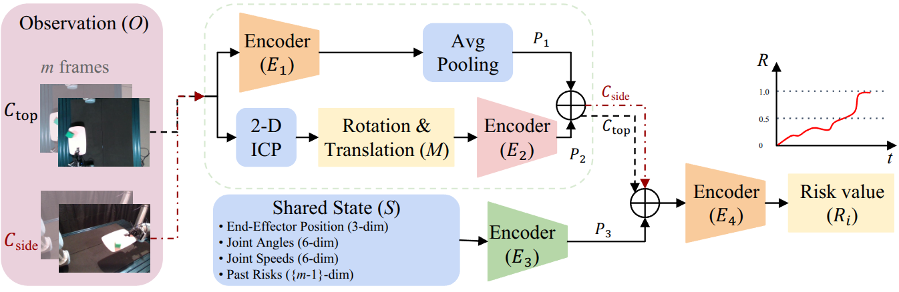

# PREFAIL: Identifying Precursors to Failures in Robotic Lift-and-Place Tasks to Improve Task Execution Performance

[](https://arxiv.org/abs/2607.16921)
[](https://github.com/zshanggu/PREFAIL/blob/master/LICENSE)

---

## Brief Introduction

PREFAIL targets non-prehensile lift-and-place tasks where a robot carries objects on a part carrier without grasping them. Because the objects are held only by friction, fast motions tend to cause failures, while slowing down increases cycle time. To address this, PREFAIL predicts the precursors to failures by analyzing how the target objects move relative to the carrier. The authors also introduce a dataset that pinpoints the latest moment an intervention can still prevent a risky manipulation from failing. In both simulation and real-world experiments, PREFAIL substantially improved both the accuracy and the timeliness of its responses to failure precursors.


<div align=center>  

</div>

-------


## Prerequisites

Python 3.10 (tested with 3.10.12) and the following packages (tested versions):

| Package | Version | Used for |
|---|---|---|
| torch | 2.6.0 (CUDA 12.4 build) | Model, training |
| torchvision | 0.21.0 | ResNet ImageNet weights, image transforms |
| numpy | 1.26.4 | Episode files |
| matplotlib | 3.7.5 | Evaluation plots |
| tqdm | any | Progress bars |
| wandb | 0.19.5 | Logging (imported; the scripts run with `--wandb-disabled`, no account needed) |

Simulation only (`simulation/requirements.txt`): mujoco 3.2.2, numpy 1.26.4, matplotlib 3.7.5, scipy,
opencv-python, imageio[ffmpeg], PyQt5, pandas, odfpy, tqdm, torch, torchvision.

## Installation

```bash
git clone <repository-url> PREFAIL && cd PREFAIL
python3.10 -m venv .venv && source .venv/bin/activate

# PyTorch with the CUDA build matching your driver (cu124 shown; see pytorch.org for others)
pip install torch==2.6.0 torchvision==0.21.0 --index-url https://download.pytorch.org/whl/cu124
pip install -r requirements.txt                 # training and evaluation

pip install -r simulation/requirements.txt      # only for generating simulated episodes (MuJoCo 3.2.2)
```

Put the episodes in `data/{train,val,test}/` (format below). The simulation needs a display with OpenGL, since MuJoCo opens a viewer window.


## Data Preparation

### Generating simulated episodes

Simulated episodes come from the MuJoCo pipeline in `simulation/` (details in `simulation/README.md`):

1. **Object meshes**: download the meshes of Get a Grip ([arXiv:2410.23701](https://arxiv.org/abs/2410.23701)),
   sort them by object type and place each type under `simulation/model/ur5e/assets/objects/<object type>/`
   (e.g. `core-bottle/`, `sem/`, `mujoco/`). They are git-ignored; only `boxes/` is in the repository.
2. **Object properties**: `simulation/configs/objects/<object type>.json` holds mass, size, friction and start
   pose per object. Missing files or objects are filled with defaults on the first run; keep the existing files
   to reproduce the recorded episodes.
3. **Run**: `cd simulation && pip install -r requirements.txt`, set `OBJ_TYPE` (the folder name from step 1) at
   the top of `run_simulation.sh`, then `./run_simulation.sh`. Each object is simulated with failure
   backtracking; raw episodes are written to `simulation/data/train_raw/raw_data/<object type>/`.
4. **Convert to the training format**: raw episodes contain the failure label (`failure_phase_value`) but not
   `state_to_init_relative`, and their `risk` is a placeholder. Convert them with
   `simulation/tools/process_raw_episodes.py` (risk ramp and relative-motion features, see
   `simulation/README.md`). Split the result into
   `train/`, `val/`, `test/` folders and pass the parent folder to `--sim-dir` with `--train-sources sim`
   (or `sim+real`).


## Training

```bash
./train.sh
```

Trains on `data/train`, validates on `data/val` every 5 epochs and evaluates the selected model on `data/test`.
Checkpoints are saved to `saved_model/` (`best_model_prefail_weighted.pth` is the one to use) and evaluation
results to `results/val/` and `results/test/`. The first run caches the processed windows in `dataset_cache/`.

## Evaluation

```bash
./evaluation.sh
```

Evaluates the checkpoint on `data/test` and prints TP / TN / FP1 (false alarm) / FP2 (late prediction) / FN
and the score. Per-episode plots and predictions are saved to `results/test/<result>/` and
`results/test/npy_results/<result>/`.

----------
## License

The implementation codes of PREFAIL are released under the MIT license.

Please see the [LICENSE](LICENSE) file for more information.

However, prior works' licenses also apply. It is the users' responsibility to ensure compliance with all license requirements.


------------

## Citation

Please consider citing:

```bibtex
@article{shangguan2026prefail,
  title={PREFAIL: Identifying Precursors to Failures in Robotic Lift-and-Place Tasks to Improve Task Execution Performance},
  author={Shangguan, Zeyu and Chitale, Rajas and Patel, Rutvik and Gupta, Satyandra K and Seita, Daniel},
  journal={arXiv preprint arXiv:2607.16921},
  year={2026}
}
```